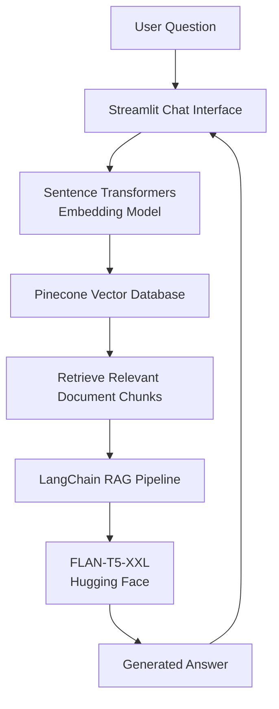

# LangChain RAG Chatbot

A Retrieval-Augmented Generation (RAG) chatbot that answers user questions using relevant information retrieved from a vector database.

The project explores how semantic search and Large Language Models can be combined to build context-aware question-answering applications.

## Architecture

- **Document processing:** Split source documents into smaller chunks for retrieval.
- **Embeddings:** Generate vector representations using Sentence Transformers.
- **Vector database:** Store and retrieve relevant document chunks with Pinecone.
- **Retrieval and generation:** Use LangChain to provide retrieved context to a FLAN-T5-XXL language model.
- **User interface:** Interact with the chatbot through a Streamlit application.




## Tech Stack

Python · LangChain · Pinecone · Hugging Face · Sentence Transformers · Streamlit

## Getting Started

### Prerequisites

- Python
- A Pinecone account and configured index
- A Hugging Face access token

### Installation

Clone the repository:

```bash
git clone https://github.com/litoguemi/chatbot-rag-langchain.git
cd chatbot-rag-langchain
```

Create and activate a virtual environment:

```bash
python -m venv .venv
source .venv/bin/activate
```

Install the required dependencies.

Configure the required credentials using environment variables or Streamlit secrets. Never commit API keys or access tokens.

### Run the application

First, execute the Jupyter notebook to prepare and index the documents in Pinecone.

Then launch the chatbot:

```bash
streamlit run app.py
```

## Implementation

The complete document-processing and indexing workflow is available in the [Jupyter notebook](./LangChain_Chatbot.ipynb).
